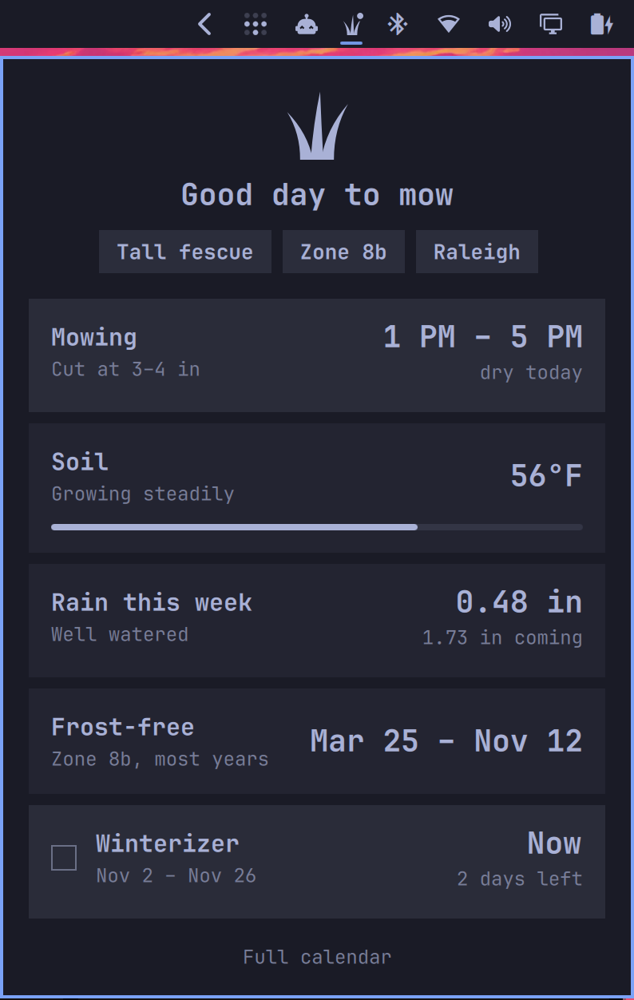

# Lawn

An Omarchy shell plugin for people who love their grass. Nothing to log and nothing to keep up: it reads the weather and the calendar and tells you what they mean for the lawn.



Click the grass in the bar for a short stack of cards:

- **Header:** what today is like ("Good day to mow", "Too wet to mow", "The lawn is resting"), and your grass, zone, and town as three chips. Click the chips to change any of them.
- **Mowing:** the dry stretch of daylight to mow in, today or tomorrow, and the height to cut at.
- **Soil:** soil temperature and how fast the grass is growing.
- **Rain this week:** what fell, what is coming, and whether to water.
- **Frost-free:** the usual last frost of spring and first of fall, which the calendar hangs on.
- **Calendar:** the job that is next, or every job whose window is open right now. Each has a check box. "Full calendar" shows the whole year.

The bar icon's blades stand taller the faster the grass is growing, and carry a dot while a calendar job is open and not yet checked off.

The grasses, the zones, and the calendar's jobs follow lawn practice in the United States, and the text is English only. The weather cards work anywhere. South of the equator the calendar shifts by six months, which has not been tried on a real lawn.

## Install

```bash
omarchy plugin add https://github.com/jpenagg/omarchy-lawn.git --enable
```

It needs nothing beyond what Omarchy ships with. Open the panel and click a chip to set your town and grass.

## Remove

```bash
omarchy plugin remove jpenagg.lawn
rm -rf ~/.local/state/lawn    # the check-offs and the cached climate data
```

## Keys

| Key | Does |
|---|---|
| `↑` `↓`, then `Space` | Move over the calendar jobs and tick one off |
| `T` | Open or close the town, grass, and zone settings |
| `C` | Show the full calendar, or just what is next |
| `R` | Refresh the weather |
| `Esc` | Close |

Middle-click the bar icon to refresh. From a script or keybinding:

```bash
omarchy-shell jpenagg.lawn toggle            # open or close the panel
omarchy-shell jpenagg.lawn done overseed     # check a calendar job off
omarchy-shell jpenagg.lawn status            # resting, today, tomorrow, wet, or hot
```

Job ids for `done`: `preEmergent`, `springFeed`, `grubs`, `overseed`, `aerate`, `fallFeed`, `winterizer` for cool-season grass; `preEmergent`, `dethatch`, `plant`, `summerFeed`, `aerate`, `grubs`, `fallPreEmergent` for warm-season.

## Settings

Set from the panel, or with `omarchy bar set jpenagg.lawn <key> <value>`:

| Key | Default | Meaning |
|---|---|---|
| `grassType` | `Tall fescue` | The grass: tall fescue, Kentucky bluegrass, perennial ryegrass, fine fescue, bermuda, zoysia, St. Augustine, centipede, bahia, or buffalograss |
| `zone` | `Auto` | USDA hardiness zone (1a to 13b), or `Auto` to estimate it from the location |
| `location` | unset | The lawn's own `{name, latitude, longitude}`, set by the town search |
| `lastFrost`, `firstFrost` | blank | Your usual last spring and first fall frost as `MM-DD`, if you know them; blank to estimate |
| `notify` | `false` | Send a notification when a calendar job's window opens |
| `conditions` | `true` | Weather lookups (see below) |

Inches and °F are used where the system locale is US English; millimeters and °C elsewhere.

## How it works out its advice

- **The mowing window** is the next stretch of daylight, today or tomorrow, that starts at 9 or later (dew), has had no rain in the three hours before it, and stays under 32°C.
- **Resting** is called when the soil, averaged over the hours around now, is below 5°C for cool-season grass or 13°C for warm-season.
- **Growth** is how well the past week's temperatures suited the grass (cool-season grass grows best around 15 to 24°C, warm-season around 27 to 35°C).
- **Water** compares the week's rain with 80% of the week's reference evapotranspiration, which is roughly what turf uses. It says nothing about watering while the grass is barely growing.
- **Climate** comes from thirty years of daily lows (1991 to 2020) at the lawn's location:
  - **The zone** is the average of each year's coldest night, which is how the USDA map is defined. The data is a weather model rather than station records, so it can land half a zone either side of the official map. Pick the zone by hand if you know it.
  - **The frost dates** are the average last night of spring at or below 1°C and first night of fall at or below 2°C. Those thresholds are the ones that best matched NOAA's 1991 to 2020 freeze-date normals at eighteen stations in six US regions: no bias on average, and typically within a week. Stations a few miles apart differ by more than that, so set `lastFrost` and `firstFrost` if you know yours.
- **The calendar** hangs each job off those frost dates. Seeding, for cool-season grass, closes 45 days before the first fall frost and opens 30 days before that; pre-emergent goes down in the month before the last spring frost; the winterizer feeding falls around the first. Kentucky bluegrass, slow to germinate, gets an earlier seeding deadline; perennial ryegrass a later one. Where frost is too rare to plan around, or with weather lookups off, the dates fall back to a table written for zone 7a that slides about eight days per zone.
- **A check box** counts for the job's current or coming window; next year's starts unchecked. A window that has just closed stays on the list for three weeks.
- **The location** is the town set in the panel; without one, the Weather widget's location; without that, a guess from the network address.

The dates are a guide. Your local extension office and the soil thermometer have the last word, and some states restrict when fertilizer may go down.

## Network and privacy

With `conditions` on, the plugin makes these requests in the background. There is one set of them however many monitors show the bar:

- `https://api.open-meteo.com`, hourly, for the forecast, sending the lawn's coordinates rounded to two decimals (about a kilometer).
- `https://archive-api.open-meteo.com`, once per location, for thirty years of daily lows at the same rounded coordinates. The result is kept in `~/.local/state/lawn/climate.json`.
- `https://geo.omarchy.org` to find roughly where you are from your network address, only when neither the lawn nor the Weather widget has a location set.

And one that only happens while you type in the town search: `https://geocoding-api.open-meteo.com` receives the text you have typed so far.

Turn it all off with `omarchy bar set jpenagg.lawn conditions false --json`. Only the calendar is then shown, following the zone you pick.

The check-offs live in `~/.local/state/lawn/log.json` and never leave the machine.

Weather, climate, and place-name data come from [Open-Meteo](https://open-meteo.com/), licensed CC BY 4.0. Its free service is for non-commercial use.

## Files

| File | Holds |
|---|---|
| `Model.js` | All the logic: parsing, validation, the calendar, and the advice. Plain JavaScript, tested with node. |
| `Service.qml` | The lawn's state, its files, and its network requests. One instance, shared by every bar. |
| `Panel.qml` | The bar icon and the panel. |
| `Card.qml`, `Chip.qml`, `CheckBox.qml`, `GrassIcon.qml`, `PlainText.qml` | The panel's pieces. |
| `SetupSection.qml` | The town search and the grass and zone pickers. |
| `Words.qml`, `i18n/` | Wording, and numbers and dates in the chosen language. English only so far; add a language by adding its file to `i18n/`. |

## Tests

```bash
node --test ~/.config/omarchy/plugins/jpenagg.lawn/tests/
```

If an edit to the plugin's code does not show up after saving, run `omarchy restart shell`.

## License

MIT. See `LICENSE`.
